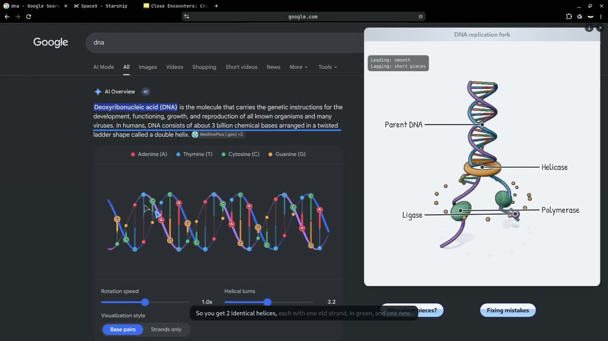

# Clicky for Linux

A Rust + Tauri port of [farzaa/clicky](https://github.com/farzaa/clicky): hold a
hotkey, ask a question out loud, and Clicky looks at your screen, answers with
its voice, and flies a little blue triangle to the button or menu it's talking
about.

On top of that it teaches: answers come with live lessons, hand-drawn 2D cards
and 3D models you can rotate, tap and explode into labelled parts, all timed to
the voice. The original Clicky didn't have the 3D part; it's new here.

Built for **KDE Plasma 6 on Wayland**. Other desktops partly work (see
[Limitations](#limitations)).

## Demo

[](https://github.com/Sr1ya/clicky/releases/download/v0.1.0/clicky-linux-demo.mp4)

**[▶ Watch the demo (2:47)](https://github.com/Sr1ya/clicky/releases/download/v0.1.0/clicky-linux-demo.mp4)**:
DNA replication, a Starship launch and a telephoto lens, each explained live
with voice, pointing and 2D/3D drawings.

## How it works

```
hold Ctrl+Alt+Space ─▶ XDG GlobalShortcuts portal ─▶ companion state machine
   └▶ cpal mic ─▶ mono 16 kHz PCM16 ─▶ AssemblyAI streaming websocket
release ─▶ ForceEndpoint ─▶ final transcript
   └▶ spectacle (or Screenshot portal) ─▶ crop per monitor ─▶ 1280px JPEGs
   └▶ Claude Messages API (SSE) with screenshots + last 10 exchanges
   └▶ strip [POINT:x,y:label:screenN] ─▶ map pixels → desktop coordinates
   ├▶ ElevenLabs or Fish Audio MP3 via rodio (Puter as backup, spd-say if no key)
   └▶ layer-shell overlay: Bézier flight → speech bubble → fly back
```

| Wayland problem | How Clicky solves it |
|---|---|
| Apps can't watch global keys | XDG **GlobalShortcuts portal** (KDE asks you to confirm once). Fallback: bind `clicky toggle` as a KDE custom shortcut |
| Apps can't read the cursor position | A tiny **KWin script** reports `workspace.cursorPos` over D-Bus |
| Apps can't screenshot silently | `spectacle --background`, falling back to the **Screenshot portal** |
| Normal windows can't stay on top or be click-through | **wlr-layer-shell** overlay layer + an empty input region |

## Source layout

| File | Purpose |
|---|---|
| `src/main.rs` | CLI subcommands, single instance, tray, panel commands |
| `src/companion.rs` | The push-to-talk → Claude → speech → pointing state machine |
| `src/audio_input.rs` | Microphone capture + resampling to 16 kHz PCM16 |
| `src/transcription.rs` | AssemblyAI v3 streaming protocol |
| `src/capture.rs` | Screenshots, per-monitor crops, JPEG encoding |
| `src/claude.rs` | Claude Messages API over HTTP with SSE streaming |
| `src/pointing.rs` | Assembles the system prompt, `[POINT:…]` parsing, coordinate mapping (unit tested) |
| `src/lesson.rs` | Lessons: routes a reply to the sandbox, synthesizes `say()` lines ahead, plays them in order and tells the page when each starts and ends |
| `src/prompts/` | The prompt as skill files: `companion.md` (who Clicky is), `skill_lesson.md` (how a program teaches), `skill_2d_lesson.md` and `skill_3d_lesson.md` (the drawing languages). Older, no longer sent: `skill_2d.md`, `skill_3d.md` (modeling craft), `pointing.md` |
| `src/speech.rs` | ElevenLabs and Fish Audio TTS + rodio playback, `spd-say` fallback |
| `src/overlay.rs` | The animated buddy: GTK layer-shell windows drawn with cairo |
| `src/visual.rs` | Real-time graphics: parses Claude's `<visual>` block and drives a transparent WebKit layer-shell surface |
| `ui/visual/` | Graphics renderer page: `visual.js` (rough.js hand-drawn cards + on-screen marks), `scene3d.js` (three.js models), bundled rough.js (MIT), three.js r186 + addons (MIT, `three.bundle.js`, rebuilt with `cd tools/three-bundle && npm install && npm run build`) and Caveat font (OFL) |
| `src/desktop_integration.rs` | D-Bus service, KWin cursor script, shortcut portal, .desktop file |
| `ui/` | Settings panel (plain HTML/CSS/JS in a Tauri webview) |

## Install

You need **KDE Plasma 6 on Wayland** (check with `echo $XDG_SESSION_TYPE`; it
should print `wayland`). Packages (.deb, AppImage) aren't ready yet, so for now
you build from source. It takes about 5 minutes.

**1. System packages** (Ubuntu/Debian/KDE neon):

```bash
sudo apt install build-essential pkg-config libssl-dev libgtk-3-dev \
  libwebkit2gtk-4.1-dev libayatana-appindicator3-dev librsvg2-dev \
  libgtk-layer-shell-dev libasound2-dev speech-dispatcher \
  ffmpeg wl-clipboard libnotify-bin git curl
```

`ffmpeg` is for saving lessons as videos, `wl-clipboard` for copy actions.
Optional: `ydotool` lets Clicky move the mouse and type for you.

On Fedora: `sudo dnf install gcc pkg-config openssl-devel gtk3-devel
webkit2gtk4.1-devel libayatana-appindicator-gtk3-devel librsvg2-devel
gtk-layer-shell-devel alsa-lib-devel speech-dispatcher ffmpeg wl-clipboard
libnotify git`

**2. Rust** (skip if `cargo --version` already works):

```bash
curl --proto '=https' --tlsv1.2 -sSf https://sh.rustup.rs | sh
source ~/.cargo/env
```

**3. Build and run:**

```bash
git clone https://github.com/Sr1ya/clicky.git
cd clicky
cargo build --release
./target/release/clicky
```

**4. First launch:**

- The settings panel opens. Paste your API keys (table below).
- KDE asks you to confirm the **Ctrl+Alt+Space** shortcut. Click OK.
- Clicky installs a `.desktop` entry, so it shows up in your app launcher
  after this. That entry also gives it permission to take screenshots.
- Run `./target/release/clicky selftest` to check monitors, screenshots and
  the microphone.

Then **hold Ctrl+Alt+Space, ask a question, and let go.**

On first launch the panel opens. Add your keys there (saved to
`~/.config/clicky/config.toml` with mode 0600), or export them as environment
variables:

| Key | Needed for | Required |
|---|---|---|
| `ANTHROPIC_API_KEY` | Claude (vision + replies) | yes |
| `ANTHROPIC_BASE_URL` | Anthropic-compatible proxy host (no `/v1`); drops fallbacks, keeps `effort: low` | no — defaults to `https://api.anthropic.com` |
| `ASSEMBLYAI_API_KEY` | speech to text | yes |
| `ELEVENLABS_API_KEY` | natural voice | no — falls back to the system voice |
| `FISH_API_KEY` | natural voice, used when there's no ElevenLabs key (`fish_voice_id` and `fish_tts_model` in the config choose voice and model) | no |

KDE will pop up a dialog asking you to confirm the **Ctrl+Alt+Space** shortcut.
You can rebind it any time in System Settings → Shortcuts → Clicky.

## Commands

```bash
clicky              # start (or show the running instance's panel)
clicky toggle       # start/stop talking — handy for a KDE custom shortcut
clicky press        # / clicky release — explicit push-to-talk edges
clicky dismiss      # stop talking and clear the drawing
clicky panel        # open settings
clicky point X Y    # debug: fly the buddy to global logical coordinates
clicky ask "..."    # a turn from words instead of the mic
clicky present FILE [--keep] # debug: play a canned reply or program without an API call; --keep builds on the drawing
clicky selftest     # check monitors, screenshots and the microphone (no keys needed)
```

## Real-time graphics: lessons

Claude answers with a small JavaScript program instead of prose, so the drawing and the
voice are one thing:

```js
step(1);
say("A V8 has 8 cylinders arranged in 2 banks of 4.");
const f = figure(35, 160, 670, 485, {title: "V8 cutaway", tilt: 20});
const block = f.box({size: [2.5, 0.65, 4.3], mat: "iron", bevel: 0.08, cut: true});
```

```
Claude stream ─▶ src/lesson.rs (strip fences) ─▶ ui/visual/lesson_worker.js (sandbox)
                                                   runs each statement once, when it's whole
     ┌── say() lines ◀───────────────────────────┤
     ▼                                            └── marks, each owned by a line
 TTS ahead of time ─▶ play in order                         ▼
     └── "line k started/ended" ──────────▶ ui/visual/lesson.js (pacer + pen)
                                              └▶ ui/visual/stage3d.js (three.js figures)
```

- **The pen is timed to the voice.** A line's marks wait until that line is heard, then spread
  across its real spoken length, so nothing appears before the words about it.
- **Statements run as they arrive,** so the voice starts within seconds of the question.
- **A follow-up builds on the drawing.** The program keeps running between turns, so `f` and
  every part still exist; the turn tells Claude what's on screen. `clear()` starts over.
- **2D** is a seeded hand: tapered wobbling strokes, handwriting (Patrick Hand), paper windows,
  name pills, graphs and timelines. Ink and paper are chosen from a coarse map of the
  screenshot, so words read on whatever is underneath.
- **3D** is one part per statement, with real materials (`mat: "steel"`) under a baked studio
  rig on a turntable. It has cutaways with hatched faces (`cut: true`), `mirror`/`copies`/`around`,
  blobs for organic shapes, `f.tick()` for working mechanisms, and labels in the margins.
- **Buttons** end a lesson with the likely next questions. Pressing one is a new turn.
- **Sounds** are synthesized (`drawing_sounds = false` in the config turns them off).

The program is model-written, so it's sandboxed. It runs in a Web Worker with the network APIs
removed and a page CSP that blocks all connections. Everything it produces is data that can
only draw. Opening a page or copying only happens when the user presses a button. If it stops
responding for 3 seconds, the worker is killed and the drawing stays.

To test: `CLICKY_MUTE=1 clicky` runs silently, `clicky present FILE [--keep]` plays a program
without the API, `clicky ask "..."` asks without the mic, and `node tools/lesson-check/check.mjs`
replays programs through the sandbox at several stream chunk sizes. The last reply is saved to
`~/.cache/clicky/last_reply.txt`.

A reply that doesn't start like a program goes down the older speech path, which still handles
`<visual>` cards and `[POINT]` tags (`visual.js`, `scene3d.js`, `sculpt.js`). The prompt no longer
teaches that format, so it mostly serves replays of old replies and plain spoken text.

## Model

Uses **Claude Opus 5.5** (Sonnet 5.5 selectable in the panel) with `effort: low`, so spoken replies start
quickly. Requests to api.anthropic.com opt into server-side refusal fallbacks
(`fallbacks: "default"`). Through a proxy, `effort: low` is still sent: some
gateways ignore `thinking: disabled`, and without the effort setting Sonnet
5.5 can spend its whole token budget thinking before it says anything.

## Limitations

- **GNOME** has no layer-shell or KWin scripting: the overlay won't stay on top
  and the buddy can't follow the cursor (it still appears when pointing).
- Screenshots on mixed-scale multi-monitor setups are cropped with a single
  scale ratio, so pointing can be slightly off on the non-primary scale.
- Each turn takes a fresh screenshot (well under 1 s through KWin, ~2 s if it
  has to fall back to spectacle or the portal).
- Figures run at about 25 fps here: GTK3 copies the WebKit surface every frame, and that cost
  dominates, not the GPU work. A smaller surface would help but isn't done yet.
- No onboarding video or analytics (both were Mac-specific/remote services).

## Cards, captions and saved lessons

Hover a card for its close, pin and full-screen buttons, and drag its title bar to move it and everything drawn on it. A pinned card rests at the screen's edge and slides out under the pointer. Words of the current line show along the bottom while Clicky talks (`voice_captions = false` in `config.toml` turns them off).

The ⤓ button by the close button, or `clicky save-video`, replays the last lesson and saves it with its voice to `~/Videos/Clicky`. The replay is spoken again, so it uses your text-to-speech allowance, and the picture is captured at about 8 to 10 frames a second.

`typeText` needs `ydotoold` running, and `handOff` opens Claude Code in Konsole.

## License

MIT. Clicky for Linux started from [farzaa/clicky](https://github.com/farzaa/clicky) (MIT, © Farza); see [LICENSE](LICENSE).
